<!-- タイピングアニメーション -->

  

 

<!-- Bio -->

  <h3>👋 ようこそ</h3>
  
<strong>Next.js / TypeScript を軸に開発を行うWebエンジニア</strong>

  

    使いやすい・見やすいデザインをモットーにWeb開発をしています。 
    実務・個人開発問わず、モダンスタックを用いたWebアプリケーション構築を得意としています。
  

 

## 💡 私の分野
* 🎨 Figmaをメインとしたデザイン構築
* 🖌️ Photoshopを利用した画像加工やマニュピレーションなど
* 🚀 Next.js (App Router) / TypeScript をメインとしたWebアプリケーション開発
* 🛠 保守性の高いコンポーネント設計、パフォーマンス最適化、モダンUIの実装

 

## 🚀 My プロジェクト
採用担当者様向けの実装デモおよびソースコードです。

| プロジェクト | 概要 | 使用技術 | リンク |
| :--- | :--- | :--- | :--- |
| My ポートフォリオ | メインPTサイト | Next.js, TS | [Demo](https://portfolio.see-u-soon.design/) / [Repo](https://github.com/onion4989/next-portfolio) |
| サブスクMEMO | サブスク管理サイト | Next.js, TS, Tailwind, Prisma, Docker | [Demo](https://subscmemo.see-u-soon.design/) / [Repo](https://github.com/onion4989/subscription-memo) |
| CAKE SHOP DEMO | 実験的なECWebサイト | Next.js, TS, Tailwind, Prisma, Docker | [Demo](https://cakeshop.see-u-soon.design/) / [Repo](https://github.com/onion4989/shop-demo) |
| CITRA | 架空のドリンクサイト | Next.js, TS | [Demo](https://citra.see-u-soon.design/) / [Repo](https://github.com/onion4989/citra) |
| GLASSROOM | 架空の眼鏡サイト | Next.js, TS, GSAP | [Demo](https://glassroom.see-u-soon.design/) / [Repo](https://github.com/onion4989/glassroom) |

---

## 🛠 技術スタック

言語とフレームワーク 

インフラとツール 

デザインツール 

---

## 📊 GitHub Stats

